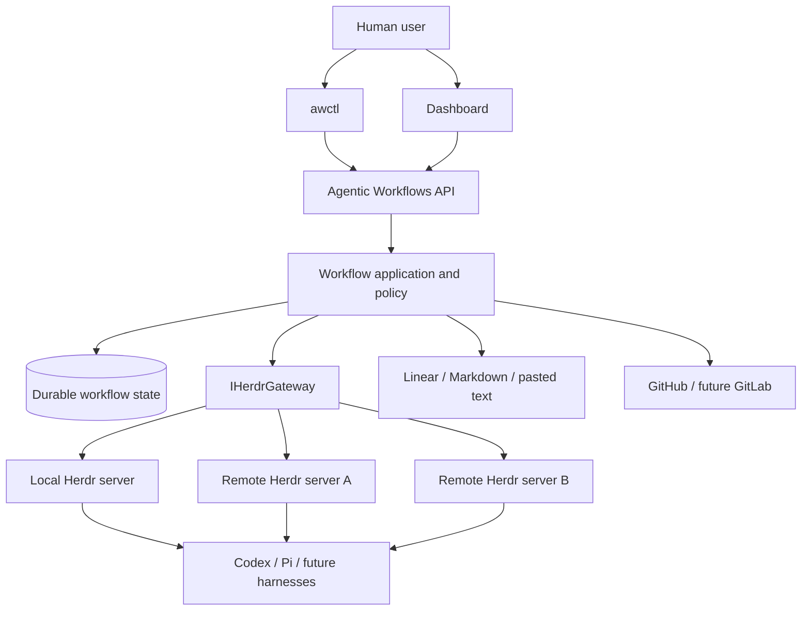
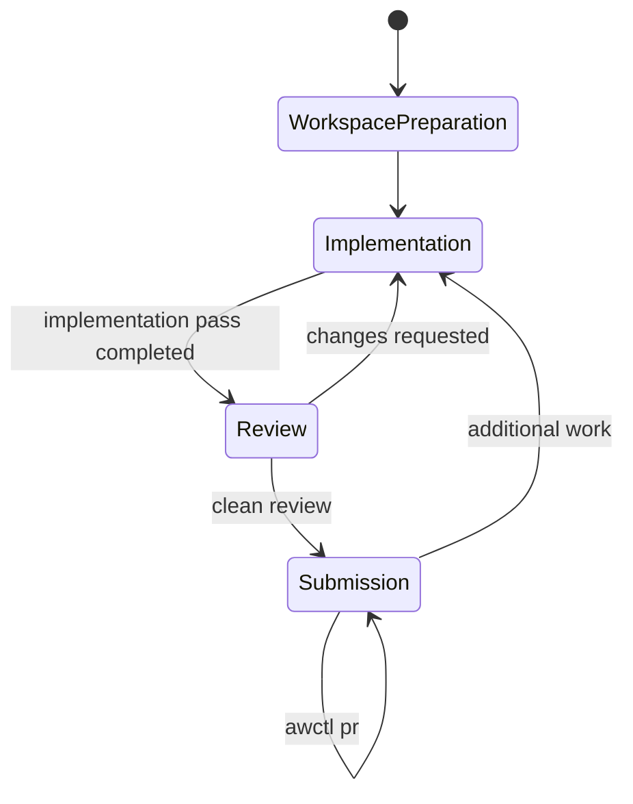

# Agentic Workflows Architecture

> Working architecture — October 17, 2026
>
> This document is the canonical current product architecture. It captures settled boundaries, design directions, and questions that still require refinement. ADRs preserve durable decision rationale and history; the workflow specification owns detailed workflow mechanics.

## How to read this document

Architectural statements have three statuses:

- A **Product Invariant** is settled product behavior or a boundary. It normally uses language such as *must*, *must not*, *required*, or *does not*. An implementation may not silently violate it. Changing one requires an explicit architecture decision and an update to the authoritative documents.
- A **Design Direction** states the preferred shape, default, or current approach. It normally uses language such as *should*, *expected*, *preferred*, or *may*. An implementation may refine it when the real code reveals a more coherent solution, provided the refinement preserves Product Invariants and the intended outcome and is reported with its rationale.
- An **Open Area** is explicitly described as open, undecided, deferred, or requiring refinement. An implementation may choose reversible local details, but it must not silently settle a material product decision.

The Task Snapshot owns the requested outcome and scope. Architecture constrains how that outcome is achieved; it does not turn every capability mentioned here into backlog for the current task. If the category of a statement is ambiguous and the distinction could materially affect scope, observable behavior, acceptance criteria, domain ownership, persistence, an integration boundary, sequencing, safety, or recovery, the ambiguity must be resolved before implementation.

No architectural direction should force an ad hoc workaround. When literal application of a Design Direction would damage the surrounding design, the Implementer should choose a coherent refinement within the documented intent and report it. If the coherent solution would change a Product Invariant or decide a material Open Area, implementation pauses for an explicit architecture change rather than hiding the divergence in code.

## 1. Product definition

**Agentic Workflows** is a local-first control plane and dashboard for human-directed agentic work. Its primary product outcome is faster agent-assisted development with trustworthy observability across tasks, workspaces, projects, and execution machines. It turns a captured task into implementation, independent review, evidence, and a human-approved submission or exported artifact.

A concise working definition is:

> From task to independently reviewed change — a local-first control plane for human-directed agentic work.

The product is intended to become a full-fledged public product. It will begin with a narrow end-to-end milestone and grow through numbered milestones in the same codebase. The initial milestone is not another disposable prototype, and there will not be separate Lite and Full editions.

Human control is a non-negotiable operating constraint rather than the product's end in itself. Agentic Workflows provides orchestration, evidence, proportionate guardrails, and safe defaults, but the human remains able to intervene, redirect an agent, use an external agent, override workflow policy deliberately, abandon a workflow, retain its workspace, and decide whether or when work should be submitted. Guardrails that materially slow ordinary development must justify that cost with a concrete risk.

## 2. Product identity and naming

The current decisions are:

- The working product name is **Agentic Workflows**.
- The repository is named `agentic-workflows`.
- The previous **Agentic Workflows Lite** name is rejected. “Lite” incorrectly suggests a reduced or temporary edition.
- The canonical CLI executable is `awctl`.
- Users may create personal aliases such as `aw` or `awf`; Agentic Workflows will not install those aliases automatically because they may collide with other software.
- **Paraorb** is only a possible future public brand for this same product. It is not a planned second product or architecture.
- No Paraorb domain or social accounts will be registered until there is enough evidence that the product merits a durable public brand.
- A preliminary search found unrelated existing uses of “Paraorb”; domain and trademark availability have not been established and require proper checks before adoption.

Commands in this document use the current canonical form:

```text
awctl start
awctl status
awctl review
awctl pr
```

Branding must not shape the domain model, storage formats, or integration contracts. A future product rename should not require an architectural rewrite.

## 3. Relationship to Agentic Workflows Prototype

**Agentic Workflows Prototype (AWP)** is the historical Python prototype and behavioral reference. It proved the path from a task through agent implementation, independent review, pull-request creation, and workspace cleanup.

AWP also revealed important problems:

- too much friction during ordinary development;
- a workflow that could bind the user too tightly to the prescribed process;
- infrastructure and execution responsibilities that do not need to belong to Agentic Workflows when Herdr already provides them;
- architectural coupling that makes a clean product implementation preferable to carrying the prototype forward unchanged.

The new product will be a clean C#/.NET application. AWP remains a source of requirements, tested behavior, terminology, and potentially reusable domain logic. It will not be ported class-for-class, and its infrastructure will not be reproduced merely because it already exists.

| Concern | AWP | Agentic Workflows |
| --- | --- | --- |
| Role | Historical Python prototype | New product and long-term codebase |
| Implementation | Python | C#/.NET |
| Execution | Prototype-owned orchestration machinery | Herdr-owned execution runtime |
| Human intervention | Comparatively process-bound | Safe defaults with explicit overrides |
| Integrations | Closely connected to the original toolchain | Explicit task, forge, and execution boundaries |
| Dashboard | Existing experience informs requirements | Detailed reporting first; workflow controls later |
| Evolution | Behavioral reference | One evolving product across v1, v2, and later milestones |

## 4. Core principles

### 4.1 Development acceleration through observability and low friction

AW exists to shorten the path from a task to a reviewed change while making concurrent agent work understandable to humans. Managers and developers must be able to see what is running, where it is running, what it costs, what evidence it produced, and what needs attention without reconstructing that history from agent terminals.

Common operations must be direct and understandable. Users should not have to debug the orchestrator merely to continue, inspect, submit, retain, or discard work. Complexity must earn its place through a concrete safety, observability, or usability benefit.

Low friction does not mean a small command set. The system may expose sophisticated controls, including changing the harness or model for a later pass, but those controls must remain comprehensible and optional.

### 4.2 Human authority with explicit overrides

The normal path should be safe. When a user knowingly wants to bypass workflow policy, the system should provide a precise override rather than trapping the user inside the process.

An override may bypass a policy such as review freshness. It must never bypass fundamental protections such as ambiguous target identity, unknown revisions, or an unbounded destructive operation.

### 4.3 Evidence before automation

The workflow and dashboard must show what happened, which exact Review Target was reviewed, which checks ran, what remains uncertain, and which actions are currently permitted. A successful agent run must not silently become a pull request, merge, or deployment.

### 4.4 Replaceable external systems

Linear, GitHub, Git, Codex, and Pi are initial integrations rather than permanent assumptions in the domain model. Jira, GitLab, Claude Code, OpenCode, and other systems should be addable through explicit boundaries.

### 4.5 Capability-aware integrations

Integrations expose their capabilities instead of pretending every provider or harness behaves identically. The workflow can use richer behavior when available and produce a clear diagnostic when a required capability is missing.

### 4.6 Local-first ownership

One Agentic Workflows installation owns the authoritative workflow state, policy, API, CLI, and dashboard. It may use Herdr to execute work on the same machine or other machines.

### 4.7 Recoverable blockers

Every blocked, invalidated, or interrupted operation must leave the user an easy, supported recovery path. AW preserves the worktree, agent sessions, snapshots, reports, fingerprints, and other available evidence instead of turning an exceptional state into a dead end. Normal recovery must not require editing the database, reconstructing hidden state, or deleting the workflow and starting over.

### 4.8 Simplicity is an architectural constraint

Flexibility must come from a few explicit seams and understandable settings, not from a combinatorial workflow-policy engine. AW should implement the smallest behavior supported by current usage evidence and retain room to revise it later.

Growing numbers of lifecycle states, interacting override scopes, special-case commands, or bespoke recovery paths are design-warning signals. If an ordinary workflow can no longer be explained clearly or implementation complexity begins driving the product model, feature development should pause while the workflow is simplified or redesigned. Shipping the complicated design and hoping to hide it in the interface is not an acceptable fallback.

### 4.9 Preserve implementation latitude

Deterministic control defines the required outcome, durable constraints, role boundaries, evidence contract, and safe lifecycle. It should not convert non-deterministic Agent Work into a mechanically prescribed edit script. Within the Task Snapshot and Workflow Instructions, an Implementer has Implementation Latitude to choose a coherent technical solution and improve the affected design as a whole.

Task preparation must resolve missing decisions that could materially change scope, observable behavior, acceptance criteria, domain ownership, persistence, integrations, sequencing, safety, or recovery. It should leave reversible local design and coding choices to the Implementer unless the repository has an explicit constraint. AW should therefore support cohesive outcome-oriented tasks rather than assume that smaller and more constrained tasks are always better. The preferred task size remains an empirical matter: completion quality, review findings, rework, usage, and elapsed time should inform later refinement.

Repository Guidance must distinguish Product Invariants, Design Directions, and Open Areas as described at the start of this document. An Implementer must not violate an invariant, may coherently refine a direction, and may choose reversible local details in an open area. When following a direction literally would produce an ad hoc workaround, preserving the surrounding design is preferable; a refinement is reported, while an invariant change or material product decision returns to architecture refinement.

Local-first therefore describes **control and ownership**, not a restriction that every agent process must run on the same host.

## 5. Product topology

Agentic Workflows has one centralized logical authoritative control plane with potentially multi-machine execution through Herdr. One AW installation spans all of its registered projects, Git repositories, workflows, and worktree records. In v1 that authority is hosted by one AW service process and one database. Future availability or scale work may introduce coordinated service replicas, but it must not create several independent authorities that can disagree about workflow state.



This is:

- a **local-first control plane**;
- **multi-machine execution** when the user configures remote Herdr machines;
- not a distributed Agentic Workflows control plane;
- not a worker fleet;
- not a message-broker architecture.

The dashboard frontend communicates only with the Agentic Workflows control-plane API. It never opens the SQLite database, invokes Herdr, or implements workflow rules directly. The API executes application commands and queries against the same domain model and transactional store used by `awctl`, so both interfaces observe identical authorization, invariants, diagnostics, and current state.

A VPS can host the authoritative Agentic Workflows installation and still satisfy the local-first model. A future multi-user, highly available, multi-controller system would be a materially different architecture and is not currently planned.

## 6. Responsibility boundaries

### 6.1 Agentic Workflows owns workflow meaning

The Agentic Workflows control plane owns:

- workflow identity and lifecycle;
- immutable task snapshots and provenance;
- implementation, validation, review, submission, and export sequencing;
- construction of authoritative agent handoffs from durable workflow data;
- role and pass identity;
- policy, preconditions, and explicit overrides;
- exact reviewed-state and validation evidence;
- durable workflow history and audit records;
- warnings, errors, and recommended next actions;
- the application commands used by the CLI and dashboard;
- task-provider and forge integrations;
- reporting and dashboard read models;
- reconciliation between recorded workflow state, Herdr execution facts, and repository state.

### 6.2 Herdr owns execution

Herdr owns:

- persistent background sessions;
- workspaces, panes, and terminal processes;
- Git worktree operations exposed by Herdr;
- starting, prompting, observing, and stopping supported agents;
- delivery of Agentic Workflows-provided handoffs to new or resumed sessions;
- harness process integration;
- execution-level concurrency;
- local and remote machine execution;
- session restoration and execution snapshots;
- the transport to saved remote machines.

Agentic Workflows should not recreate these capabilities.

### 6.3 Git and forges own their facts

Git remains authoritative for revisions, branches, and repository contents. GitHub or another forge remains authoritative for pull requests or merge requests. Agentic Workflows records verified references to those facts and applies its workflow policies to them.

### 6.4 No Agentic Workflows worker

Agentic Workflows does not have its own worker process. A Herdr server on each execution machine is already the execution boundary.

A `Job` or `Operation` may remain a workflow-domain concept, but it is not a message delivered to an Agentic Workflows worker. It represents one bounded action whose execution is delegated to Herdr and whose evidence is recorded by the control plane.

### 6.5 No RabbitMQ

RabbitMQ and equivalent broker infrastructure are not required. The architecture does not include:

- work-order queues between a control plane and workers;
- worker leases or worker heartbeats;
- worker capability negotiation;
- distributed job placement;
- broker-based retry or delivery semantics;
- control-plane-to-worker transport protocols.

The C# application may use ordinary in-process background handling and durable database records for application commands. Herdr provides persistent execution; Agentic Workflows reconciles with it after restart or disconnection.

## 7. Herdr integration

### 7.1 Standalone application, not a Herdr plugin

Agentic Workflows begins as a standalone C# application. Its database, API, dashboard, upgrade lifecycle, and workflow state do not live inside a Herdr plugin.

A small Herdr plugin may be useful later for discovery, shortcuts, or embedded actions, but it is not the initial deployment or persistence boundary.

### 7.2 Explicit gateway

All Herdr access goes through an application boundary such as `IHerdrGateway`. Workflow-domain code must not invoke Herdr commands directly.

The initial gateway exposes the small AW-semantic surface required by concrete workflows rather than mirroring Herdr's complete CLI. It can:

- inspect an execution target's compatibility and relevant capabilities;
- prepare or inspect a Workflow workspace;
- start a new Managed Agent Pass or resume its selected eligible session;
- observe or interrupt the correlated execution;
- obtain the correlated output and Result Envelope transport outcome; and
- tear down resources owned by one resolved Workflow.

Stable target, workspace, session, execution, and AW Operation identifiers cross this boundary so durable workflow records can be reconciled with Herdr facts. The gateway does not expose a generic Herdr command runner to domain code or acquire one method per Herdr CLI command. A CLI-backed infrastructure adapter translates AW requests into the required Herdr commands. Exact C# method names and command composition remain implementation choices, and the surface grows only when a concrete workflow requires another capability.

An execution target supplies a structured compatibility response containing its Herdr or integration-contract version and named supported capabilities. Each gateway operation declares only the small capability set it actually requires, and AW validates that set before starting a mutation. A missing mandatory capability rejects that Operation with a precise diagnostic and Recovery Plan; it does not disable unrelated operations that the same target can still perform. AW therefore does not require an exact Herdr version when the structured contract and required capabilities are compatible. Capability cache lifetime, refresh mechanics, and wire-level field names are infrastructure details unless observed Herdr behavior proves that they affect workflow correctness.

### 7.3 CLI-first transport

The initial gateway implementation should use Herdr's official CLI wrappers and structured JSON output.

Reasons:

- the CLI is the normal Herdr automation surface;
- it handles platform-specific local transport details;
- it supports routing commands to configured remote machines;
- commands are reproducible during human debugging;
- child-process overhead is negligible compared with agent execution time;
- it avoids premature coupling to the low-level socket protocol.

The C# implementation must use argument-list process invocation rather than interpolating commands through a shell. Provider output is untrusted data and must never become executable shell input.

### 7.4 Future socket transport

The raw Herdr socket API may be added behind the same gateway for long-lived event subscriptions, lower-latency dashboard updates, or deeper local integration.

v1 does not require every operation to use the raw socket. A hybrid implementation is acceptable: CLI commands and snapshots for control, with socket subscriptions introduced when live-event requirements justify them.

### 7.5 Remote machines

Agentic Workflows stores a Herdr execution target with each operation:

```text
ExecutionTarget
├── Local
└── HerdrMachineId
```

Remote operations use Herdr's saved-machine routing rather than an Agentic Workflows worker protocol. A remote execution machine is expected to have:

- Herdr;
- the selected harness, such as Codex or Pi;
- Git and the project's toolchain;
- the repository or artifact workspace;
- credentials required by the harness, repository, and tools.

Agentic Workflows does not initially install, update, or configure those remote dependencies. The user prepares and verifies the machine through Herdr.

### 7.6 Structured completion and correlation

Herdr execution state alone is not sufficient proof that a particular workflow pass completed. An idle agent or pane must not be interpreted automatically as successful completion of the current operation.

Every bounded operation needs an immutable Agentic Workflows operation identifier. Prompts and result handling should produce a structured result correlated to that identifier. Agentic Workflows then verifies the result against repository or artifact facts, including the exact Git revision when applicable.

Terminal-screen scraping must not be the primary integration contract.

## 8. Milestones

v1, v2, and later numbers describe delivery stages of the same Agentic Workflows product. They do not represent Lite versus Full editions or local versus distributed products.

### 8.1 Initial E2E Milestone

Before attempting the entire v1 surface, development should complete one narrow, usable, production-shaped end-to-end milestone:

```text
Captured task definition
    → durable workflow record
    → Codex started through Herdr
    → implementation result and exact proposed tree captured
    → independent Reviewer started through Herdr
    → findings, when present, bound to the exact Review Target and routed through repair
    → human-approved awctl pr
    → deterministic commit, push, and GitHub pull-request creation
    → lifecycle shown in a minimal read-only dashboard
```

This milestone should have production-quality identifiers, durable state, diagnostics, and restart reconciliation. It intentionally starts with Linear as its one Task Source, one repository, Codex as its one harness, one execution target, and a minimal dashboard. Using the primary real Task Source ensures that the milestone exercises Agent Instructions extraction, immutable source revisions, and changed-requirement handling rather than validating only internal workflow machinery.

It must validate:

- that the new workflow is materially less frustrating than AWP;
- that Herdr cleanly owns execution responsibilities;
- that completion and review evidence can be correlated reliably;
- that both clean-first review and findings-to-repair routing are covered without deliberately introducing a defect into genuine implementation work; controlled end-to-end scenarios may use synthetic Result Envelopes to exercise the latter path;
- that exact reviewed content can be committed and submitted through deterministic Git and GitHub actions without allowing agents to own those actions;
- that the dashboard adds workflow understanding beyond Herdr's execution UI.

The Initial E2E Milestone is the first implementation step, not another product or throwaway prototype. Acceptance is established by end-to-end tests that exercise the complete Linear-to-pull-request cycle. The milestone must make later self-hosting possible, but using Agentic Workflows to develop itself is not an acceptance requirement and may begin only in a later stage. Until then, development may continue through the existing prototype. Merge remains a separate human action.

The initial submission milestone needs to create a new GitHub pull request safely. Updating an already-open pull request with a later reviewed batch and additional commit is an immediate follow-up, not a capability deferred to the end of v1. It may be sequenced alongside the first Task Source expansion according to implementation and end-to-end test evidence.

### 8.2 Required v1 product scope

v1 expands the proven milestone to include:

- a durable local control plane and application API;
- Linux as the officially supported operating system;
- an architecture that preserves a practical path to Windows and macOS;
- Herdr as the required execution runtime;
- Codex and Pi support, proving that the workflow is not Codex-specific;
- Linear tasks, Markdown task files, and pasted or standard-input task text;
- Git-backed software-development workflows;
- local-only research and artifact workflows with no remote repository;
- independent review in a separate initial agent session;
- concurrent workflows where workspaces do not conflict;
- a sophisticated, detailed, system-wide read-only dashboard;
- token-usage and execution telemetry suitable for comparing work across passes, workflows, projects, workspaces, models, and time periods;
- `awctl` commands for workflow mutation and control;
- manual pull-request submission with explicit force and draft options;
- durable interruption detection and restart reconciliation;
- clear, structured, unambiguous errors and warnings;
- explicit workspace retention and cleanup controlled by the user.

Multi-machine execution may be available through Herdr without changing the Agentic Workflows control-plane topology. It should be validated after the local E2E path is reliable rather than becoming a prerequisite for the Initial E2E Milestone.

Markdown task files and pasted or standard-input task text are the first Task Source expansion after the Initial E2E Milestone. They should be implemented before broader v1 provider and workflow expansion so the provider-neutral Task model is tested early and quick local work does not remain dependent on Linear.

### 8.3 v2 direction

v2 is expected to add workflow controls to the dashboard. Those controls must invoke the same application commands as `awctl`; the dashboard must not become a second orchestration implementation.

Other later capabilities may include additional task providers, forges, harnesses, richer resource reporting, and more configurable policies. They remain improvements to the same product.

### 8.4 v3 organizational direction

v3 may introduce organization-oriented identity and access capabilities, including named users, authentication, authorization, roles, and actor-attributed audit records. These are important for a company deployment but provide no current benefit to the initial single-operator workflow. v1 does not build dormant user-management or RBAC subsystems merely to reserve this direction; the existing API boundary and database migrations provide a practical seam when the requirement becomes real.

### 8.5 Deliberately outside v1

- Dashboard workflow mutation and control.
- Application-managed user accounts, authentication, authorization, teams, and RBAC.
- Resource-aware or token-price-aware scheduling, throttling, quotas, or automatic concurrency limits.
- Organizational enforcement that prevents developers from working outside a defined AW workflow.
- Continuous or periodic monitoring of task-source changes during an active pass. Boundary checks before a new Handoff remain required.
- Automatic interruption when requirements change.
- Automatic submission as required behavior.
- Automatic merge.
- Automatic workspace cleanup.
- A general third-party plugin marketplace.
- Official Windows and macOS support.
- Formal review inside the implementation session.
- A distributed, highly available Agentic Workflows control plane.

## 9. Domain model

The following concepts must remain distinct:

- **Task definition:** normalized user requirements and provenance.
- **Task:** the provider-neutral unit of requested work captured from a Task Source. One Task may be delivered through one or more Workflows.
- **Workflow scope:** a value on a Workflow: either `WholeTask` or `NamedSlice(name)`. A named Task Slice is therefore scope, not a separate aggregate, identity, or lifecycle.
- **Workflow variant:** an optional identity component for a competing candidate implementation of the same Task Snapshot and Workflow Scope. Variants may deliberately use different models or approaches, but do not narrow or repartition the Task requirements.
- **Workflow:** the durable end-to-end process for one Task under one Workflow scope. `WholeTask` is the ordinary default and is not represented as an implicit or unnamed slice. A Workflow contains an auditable sequence of immutable task snapshots when the user explicitly adopts changed requirements and owns exactly one branch, worktree, implementation/review loop, and pull request. One Workflow does not own multiple mutable worktrees or multiple pull requests.
- **Workflow phase:** the kind of work the Workflow is currently progressing through. The Initial E2E set is exactly `WorkspacePreparation`, `Implementation`, `Review`, and `Submission`.
- **Attention Requirement:** one active typed reason that requires human input, with its own Recovery Plan and resolution history. A Workflow may have several active requirements.
- **Attention Required:** the derived gate that prevents AW from starting an otherwise eligible next action while one or more applicable Attention Requirements remain unresolved. It retains the Workflow's current phase and is neither a phase nor a failure verdict.
- **Operation:** one immutable bounded attempt to perform an action, such as implementation, review, validation, submission, export, or cleanup. A retry or resume is another Operation linked to the predecessor it follows or supersedes.
- **Operation status:** exactly one of `Pending`, `Running`, `Completed`, `Failed`, or `Interrupted` for one concrete Operation. It is not another Workflow phase or its semantic result.
- **Execution observation:** AW's timestamped last verified view of the corresponding Herdr execution, including whether the execution target was reachable when observed. It distinguishes external facts from AW's durable intent and operation state.
- **Pass:** a numbered implementation or review attempt within a workflow.
- **Agent role:** the purpose of an invocation, such as Implementer or Reviewer.
- **Agent session:** a harness conversation or execution context. Role and session are not the same abstraction.
- **Execution target:** the local Herdr server or a saved remote Herdr machine.
- **Workspace:** retained files, repository state, and artifacts associated with the workflow.
- **Evidence:** verified facts supporting a workflow decision, including revision, validation, review, warnings, and provenance.
- **Submission:** deterministic establishment of the authorized commit, push, and pull request or merge request from exact reviewed content.
- **Export:** delivery of outputs from a local-only artifact workflow.

v1 keeps Task Slice creation deliberately small. `awctl start TASK-ID --slice NAME` requests a new independently identified Workflow for that explicit scope. It does not create a child Linear Issue, ask an agent to decompose the Task automatically, build a dependency graph among slices, or store a separate slice requirements document. The user-declared name is both an agent-visible scope label and part of branch identity; it is not merely a technical branch suffix. The Handoff includes the complete authoritative Task Snapshot and stable slice name and instructs the role to work only within that scope. AW does not mechanically prove the semantic boundary; genuine ambiguity produces a human-decision result rather than silent scope expansion.

A Task Slice must not be used to represent alternative implementations of the same scope. A slice answers which part of the Task a Workflow addresses; a Workflow Variant answers which competing candidate implementation of that same part is being attempted. Planned Variant support will allow several Workflows to share one Task Snapshot and Workflow Scope while retaining independent branches, worktrees, agent configurations, passes, reviews, and lifecycle. A common use case is comparing implementations produced by different models before choosing one for submission. Variant support is not part of the Initial E2E Milestone and is targeted for v1 or early v2. Until it is implemented, AW continues to reject duplicate Workflows for the same Task and scope rather than disguising alternatives as slices. Exact commands, candidate comparison, winner selection, and cleanup behavior remain to be specified.

A Task may retain Workflows with both `WholeTask` and `NamedSlice(name)` scopes, including a Named Slice Workflow created after a Whole Task Workflow was completed or submitted. The later Workflow captures the then-current Task Source and does not supersede, repartition, or reinterpret earlier Workflows. AW does not attempt to prove that Workflow scopes are non-overlapping. Workflows for different scopes of the same Task may execute concurrently in their separate worktrees; AW still rejects a duplicate Workflow for the same scope under the current identity rules. Overlap is handled through ordinary Git integration and a fresh review rather than global serialization.

`awctl start` never silently reuses a worktree. When the same Task and Workflow Scope already has a retained Workflow, the command stops without changing state or launching an agent. It reports enough status to expose unfinished or reviewed-but-unsubmitted work and directs the user to an explicit continuation action, such as resuming or submitting that Workflow, or to a different named scope. The conditions under which a later Workflow may reuse the same scope after the earlier Workflow has reached its final external outcome remain to be specified.

Changing the Linear Issue does not authorize a duplicate Workflow for the same scope. The user resumes the existing Workflow and explicitly adopts the new Task Snapshot, which returns execution to implementation before review. Once that Workflow has a pull request, continuing the same pull request remains an explicit continuation of that Workflow; a separate pull request for the Task requires `--slice` and a distinct named scope.

AW persists confirmed Submission identity while a Workflow is retained: provider, repository, pull-request number and URL, head branch, Workflow, and scope. The forge is authoritative for the request's mutable open, closed, or merged status. When live status affects an operation on that Workflow, AW queries the exact recorded request.

For a Linear-backed Task, v1-generated pull-request content includes a deterministic closing reference such as `Fixes DEV-123`, even though the branch identity also contains the Linear Issue key. This makes the intended GitHub–Linear linkage and merge-triggered completion explicit, including when several slice pull requests belong to one Task. Removing the redundant reference requires a later explicit decision supported by evidence that branch-based linking is sufficiently reliable; dogfooding does not change this rule automatically.

v1 does not treat retained AW history as a project-wide or cross-installation registry. `awctl start` checks the candidate branch against relevant local Git state and live branches on the configured remote. An existing branch stops creation and directs the user to existing work or `--slice`; an absent branch permits creation without a historical pull-request search. Cleanup or external branch deletion can therefore make the same Task and scope available again. Duplicate execution after the shared branch evidence disappears, and the race in which two machines start before either publishes shared Git state, are accepted user responsibilities in v1.

For Linear, the candidate branch identity is derived directly from the normalized Issue key and optional normalized slice name; the mutable Issue title is excluded. Repository context provides the project boundary. Exact prefix and separator syntax remain an implementation detail, but the Whole Task and Named Slice forms must avoid Git ref prefix conflicts.

Commands after Workflow creation normally select the Workflow from the caller's current managed worktree. From outside a managed worktree, the caller or dashboard supplies the immutable Workflow ID explicitly. AW does not resolve an existing Workflow from Task ID, slice label, branch prefix, or title when more than one Workflow may exist, and it refuses missing or conflicting worktree identity instead of guessing. This keeps the common `awctl review`, `awctl pr`, and `awctl cleanup` path short while preserving an unambiguous automation path.
- **Merge:** a separate future operation; it is not part of submission.
- **Deployment:** a production operation and intentionally not represented by “publish.”

The term **worker** is not part of the Agentic Workflows runtime model. Herdr machines and servers are execution targets, not Agentic Workflows workers.

## 10. Representative workflow lifecycle



The diagram contains only Workflow phases. `ReadyToSubmit`, `Submitted`, `Retained`, and cleanup are not phases: they are respectively derived eligibility, durable Submission Evidence, continued existence of the Workflow, and deletion of that Workflow. A clean review advances the Workflow to `Submission`, where readiness is derived from current evidence. Successful submission leaves the retained Workflow in that phase until additional work returns it to `Implementation`; cleanup removes it rather than creating a `CleanedUp` phase. A Workflow may be in the `Review` phase while its current Review Operation is `Pending`, `Running`, `Completed`, `Failed`, or `Interrupted`. Validation performed by the Implementer or Reviewer is evidence inside that pass rather than a mandatory standalone Workflow phase.

`Submission` is the deterministic umbrella for establishing the authorized commit, pushing the branch, and creating or updating the forge change request. v1 exposes that umbrella as `awctl pr` for GitHub pull requests. A future GitLab adapter may create merge requests through the same phase; a merge request is GitLab's change-request form and does not make merge part of Submission. Commit, push, and forge-request actions remain explicit internal boundaries so later versions may expose them separately if real usage justifies the additional public surface.

The Initial E2E Milestone has no single authoritative Workflow Status or Workflow Outcome enum. Current user-facing state is a projection of independent durable facts: Workflow Phase, current Operation and Execution Observation, active Attention Requirements, explicit abandonment, current clean-review eligibility, and Submission Evidence. Labels such as `Review · needs attention`, `Submission · ready`, `Submission · submitted`, and `Abandoned after Implementation` are query and presentation results, not competing stored authorities. This permits additional Implementation work after Submission without inventing a transition out of a terminal `Submitted` state.

A Workflow has no Failed phase or terminal Failed status. Failure and interruption belong to the concrete Operation that encountered them. The Workflow remains in its current phase, preserves all available work and evidence, and exposes applicable Attention Requirements and recovery actions. Retrying or resuming never reopens or mutates the earlier Operation: AW creates a new immutable Operation linked to its predecessor, and a later successful Operation may supersede the failed attempt for current routing without rewriting its history. Whether that new Operation resumes an eligible agent session or starts another one is an independent execution choice governed by session policy and any valid override. Only an explicit user-controlled lifecycle decision, such as abandoning the Workflow or cleaning it up, ends further work; the exact abandonment and cleanup command semantics are specified separately.

Conditions that require human input do not multiply the phase graph. AW creates an Attention Requirement only when safe continuation requires a human policy choice or manual/external action. It does not mirror every `Failed`, `Interrupted`, or temporarily unreachable Operation as another attention record: those already have Operation Status, diagnostics, and a Recovery Plan. The Initial E2E reason set is limited to `TaskChangeDecision`, `PassBudgetContinuation`, `LinearCancellationDecision`, and `RepositoryReconciliation`. Session loss, result-contract failure, review staleness, provider failure, and temporary unreachability remain represented by their existing Operation, evidence, eligibility, and Recovery Plan concepts. Another reason is added only when a concrete end-to-end scenario cannot be represented without ambiguity. Attention Requirements are current derived alerts, not records the user manually marks resolved. At each deterministic boundary and before an intended recovery action, AW revalidates all available facts, exposes every requirement that still applies, and automatically removes every current projection that no longer applies. One ordinary action may therefore clear several alerts; creation and clearance events remain in the Workflow Audit Trail. There is no `mark-resolved` command or requirement-by-requirement repair checklist. The derived Attention Required gate prevents AW from automatically starting the next gated action while any requirement currently applies, but does not retroactively fail a completed Operation or automatically interrupt a running pass. `awctl cleanup --force` remains the direct escape hatch when the user chooses to discard the Workflow instead of recovering it.

AW also keeps Operation Status distinct from its last Execution Observation. Recording the intent to start a Reviewer does not prove that Herdr started it, and losing contact with Herdr does not prove that the Reviewer stopped. If the Reviewer was last confirmed running and its execution target becomes unreachable, AW preserves that timestamped fact and separately reports current reachability as unavailable. It does not change the Operation to Failed or Interrupted. The Initial E2E status set is exactly `Pending`, `Running`, `Completed`, `Failed`, and `Interrupted`. A user-requested stop such as Ctrl+C and a positively confirmed vanished execution are both `Interrupted`, with a typed interruption reason preserving the cause. AW does not add a `Canceled` Operation Status because Linear Task cancellation is a different concept. Review findings and other successful semantic outcomes belong to the Result Envelope rather than Operation Status. The model must represent uncertainty explicitly instead of manufacturing a precise lifecycle transition from missing information. The minimal Attention Requirement reason set still requires refinement, but these distinctions are architectural requirements.

## 11. Task ingestion and identity

### 11.1 Supported sources

v1 accepts tasks from:

- Linear;
- a Markdown file;
- pasted text or standard input.

Pasted and Markdown tasks are required because some work should not be tracked in Linear, including small research tasks and one-off artifact production.

All sources normalize into an internal task definition. Provider-specific concepts, such as a Linear status, remain optional provider behavior rather than core workflow assumptions. For a Linear-backed Task, AW automatically moves the Task to the configured In Progress state as part of successful Workflow startup; the user does not perform that transition manually. Project setup resolves and persists the concrete Linear workflow-state identifier instead of relying on an English display name during each run. AW automatically selects an unambiguous active-work state when possible and requests a one-time configuration choice only when resolution is ambiguous. Startup validates that the saved state still exists and belongs to the Task's Linear team.

A read-only admission check stops without creating a Workflow or worktree when the Linear Task is already in a terminal Done or Canceled state; the user must deliberately reopen it in Linear before retrying. An existing configured In Progress status is an idempotent success and is not rewritten. AW then durably prepares the Workflow and worktree, updates Linear when required, and only afterward launches the first managed agent pass. If the Linear update fails, startup stops without launching the agent while retaining the prepared Workflow for retry. If the update succeeds but agent launch fails, AW leaves the Task In Progress and retains the Workflow for retry rather than attempting a compensating status rollback. After startup, AW observes and reports later Linear status changes but does not write or reassert status. `awctl pr` does not mark the Task Done. The existing GitHub–Linear integration owns later PR-driven transitions, including completion when its pull request is merged. AW does not use provider status as proof of workflow correctness, review validity, or submission state.

If an active Linear-backed Workflow is changed to Canceled, AW does not automatically interrupt a Managed Agent Pass already running. The pass may finish so its work and Result Envelope can be preserved, but AW pauses before the next managed handoff and requires an explicit user decision. The user remains free to interrupt immediately with Ctrl+C or by exiting the agent; that follows the ordinary interruption and recovery contract rather than a special cancellation mechanism. When no pass is active, the cancellation pause applies as soon as AW observes the state. AW does not reopen the Linear Task or roll back its status.

If an already-active Workflow observes that the Linear Task became Done, AW records and displays a warning but does not pause or alter routing. Done can be an automatic consequence of another linked pull request and is not reliable evidence that the user intended to stop this Workflow. This differs deliberately from Canceled. The Workflow continues against its immutable Task Snapshot, and AW still performs no corrective Linear status write.

All textual task sources use one deterministic requirements-extraction rule. When a recognized `Agent instructions` section is present, that section is the authoritative agent-facing requirements content and the remaining content is retained as context and provenance. When the section is absent, the complete task content is authoritative. Markdown files and pasted text are intended primarily for quick work and therefore are expected to use the complete-content fallback in most cases; they do not require a special section.

The same missing-`Agent instructions` policy applies to Linear, Markdown files, pasted text, and standard input so that source types do not create separate workflow paths:

- `warn` is the default: emit a prominent warning, then continue automatically using the complete task content;
- `require`: refuse to create or adopt the Task Snapshot and do not start the next agent pass until the section is supplied or the policy is explicitly overridden;
- `ignore`: continue silently using the complete task content.

A README supplied as a task file is treated as a Markdown source and follows the same rule.

### 11.2 Immutable task snapshot

At workflow creation, Agentic Workflows captures an immutable task snapshot containing normalized requirements, the complete available source context, and provenance including source type, source identifier, revision or content hash, and capture time. The requirements fingerprint covers the captured `Agent instructions` section when present and otherwise the complete task content. Every agent pass is bound to exactly one immutable snapshot.

Linear and Markdown file sources can be re-read at handoff boundaries to detect later changes. Pasted text and standard input become immutable sources when captured because there is no external source to re-read.

Agentic Workflows must not silently replace the active snapshot when the source changes. A source change does not automatically interrupt an active agent pass. The user may still interrupt manually, including with Ctrl+C; interruption and recovery are separate lifecycle behavior. Before the next handoff, AW checks the source and, when it observes a previously unhandled source revision, pauses for the user to retain the active snapshot, explicitly adopt the new revision as another immutable snapshot, or stop.

The decision is recorded for that exact source revision and is not requested again at every later phase unless the source changes again. Retaining the active snapshot leaves the workflow and its evidence unchanged. Adopting a new snapshot preserves earlier snapshots and evidence for audit, invalidates conclusions that depend on the previous requirements, and routes the workflow to implementation before any further review. An Implementer and Reviewer must never unknowingly operate against different snapshots.

Source changes never retroactively alter a completed or submitted Workflow, its Review Report, or its pull request. A later Whole Task or Task Slice Workflow for the same Task captures the then-current source as its own initial Task Snapshot. If a source changes while a Workflow is still active, the ordinary handoff-boundary retain/adopt/stop rule continues to apply to that Workflow.

### 11.3 Internal identity

Every task, workflow, operation, pass, and evidence record receives an immutable generated internal identifier. Human-readable names are presentation metadata.

For a Linear-backed Task, a key such as `DEV-123` is also the stable external identifier used in branch identity for v1; the mutable title is not included. Pasted and Markdown Tasks receive a random 128-bit identifier at capture because a user-supplied name alone cannot establish uniqueness without a shared registry. A branch may include a readable slug, but the generated value is its identity. AW checks candidate local and live-remote branches and regenerates before creating state if an actual collision exists. Capturing identical source text on different machines intentionally creates independent identities; AW does not use a content hash as identity.

The exact internal identifier and branch-format syntax remain open.

## 12. Workspaces and repository modes

### 12.1 Software repositories

Software work occurs in an isolated branch and worktree managed through Herdr. Multiple workflows may operate in the same repository when they use separate branches and worktrees.

Agentic Workflows records workspace ownership and workflow mappings. Herdr performs workspace and worktree execution operations.

### 12.2 Local-only artifact workflows

Non-remote artifact work is a hard v1 requirement. A research workflow may, for example, produce a PDF report that the user does not want stored on GitHub.

One consistent implementation is a managed local Git repository in an Agentic Workflows-owned workspace without a configured remote. Git supplies snapshots, identity, and change tracking even when the user does not regard the output as a software project.

Agentic Workflows must not initialize Git in an arbitrary user directory without explicit permission. It should create a managed workspace and export approved outputs to a user-selected destination.

Binary artifacts may require rendered or semantic review rather than a text diff.

### 12.3 Retention and cleanup

Completion, submission, merge, export, retention, and cleanup are separate operations. v1 does not automatically remove a workspace after review, submission, export, or merge.

The user decides when to clean up. Retention permits inspection, summaries, and further discussion with an agent after formal completion.

Explicit abandonment stops all automatic routing for the selected Workflow while retaining its managed worktree, sessions, Task Snapshots, evidence, reports, events, and current state. It is not failure or cleanup. An explicit resume command revalidates current external and workspace state, exposes any resulting Attention Requirements, and then allows ordinary routing to continue.

Explicit cleanup is also the v1 history-retention boundary for the selected Workflow. It removes the verified managed workspace and associated AW-owned task execution state, including detailed reports, audit events, and Submission evidence; v1 does not retain a permanent tombstone solely to prevent the Task from being started again. Sibling Workflows for the same Task remain independent and are not removed by cleaning one Workflow. The dashboard therefore provides complete history for retained Workflows, not a permanent history of every project Task. A future centralized project-management mode may define longer retention and cross-machine admission rules.

Ordinary cleanup may stop when current policy or an unresolved Attention Requirement makes deletion unsafe or ambiguous. `awctl cleanup --force` is instead an invocation-scoped destructive escape hatch. After resolving the exact Workflow and verifying its managed-target boundaries, AW asks Herdr for one bounded best-effort forced teardown of every process, pane, session, and worktree owned by that Workflow. Herdr may escalate from graceful interruption to forced termination of the owned process tree before removing the worktree with its required local Git bookkeeping. Open, idle, running, failed, unreachable, and uncertain execution states affect the reported outcome but never prevent the attempt.

After the Herdr attempt returns or times out, AW always deletes every piece of local AW-owned state for the selected Workflow. Fully confirmed teardown returns success; any failed or unconfirmed external component returns a structured partial-cleanup result and distinct non-zero exit code with the last-known target, managed path, component outcomes, and manual-cleanup instructions. There is no Workflow retry because the state is gone. Forced Cleanup still cannot bypass immutable Workflow identity, resolved-path, or deletion-boundary verification, target an arbitrary directory, affect sibling Workflows, or become a saved default.

Cleanup has no remote Git or forge effects. It never deletes a branch, rewrites history, pushes, closes or deletes a pull request, or changes Linear. AW itself does not invoke `git` as part of cleanup. AW requests session and managed-worktree teardown through Herdr, which owns the workspace and may perform the local Git worktree bookkeeping required to remove it safely. Ordinary cleanup deletes AW state only after the teardown result is durably known.

If Herdr cannot complete or confirm forced teardown, a managed process or workspace may remain orphaned; AW reports that uncertainty rather than claiming success. AW retains no Workflow-specific orphan record, tombstone, cleanup receipt, audit history, or other durable state afterward. Ordinary infrastructure logging follows the general logging policy and is not a hidden Workflow-recovery registry. This implementation boundary does not permit either component to mutate project history, refs, remotes, forge state, or task state as part of cleanup.

Post-completion interaction remains outside the controlled workflow until the user starts another workflow operation. If an informal follow-up changes files, those changes become unreviewed and must not be submitted silently.

The retained worktree is not a closed appliance. A human may edit it directly, open an external agent there, or perform Git operations outside AW. AW does not prevent or roll back that Unmanaged Work. It records only the resulting state that it can observe; it does not fabricate a Managed Agent Pass or claim to possess the external agent's instructions, reasoning, or execution history.

## 13. Harness architecture

v1 supports:

- **Codex**, the primary initial harness;
- **Pi**, required before v1 completion to prove that the design is not Codex-specific.

Claude Code and possibly OpenCode are expected later.

Herdr owns the process-level integration with supported harnesses. Agentic Workflows owns workflow-level profiles and capability requirements, including:

- starting a fresh role session;
- resuming an existing session;
- selecting a model or reasoning configuration when supported;
- sending instructions;
- observing semantic state;
- requesting or receiving structured completion results;
- interruption and cancellation;
- usage information when available.

Agentic Workflows should not reproduce a complete process adapter for functionality Herdr already supplies. Its harness boundary maps workflow intent and capability requirements onto Herdr operations.

Implementation and review have independent configured defaults for harness, model, mode, and session reuse. The session-reuse setting determines whether a later pass normally resumes an eligible earlier session or starts a new one. A user may override that session choice for the next applicable pass only; after that pass starts, later passes fall back to the configured session-reuse setting.

By contrast, choosing a different model for a role changes the workflow-level Role Model Selection. It applies to every later pass of that role until the user changes or clears it, at which point resolution falls back to the applicable configured default. Implementer and Reviewer model selections remain independent.

The current preferred behavior is for a role's harness selection to persist in the same way as its model selection, but this remains provisional until usage validates it. The lifetime of mode changes also remains open. v1 must not introduce a generalized user-configurable system of arbitrary override lifetimes merely to anticipate these possibilities.

The user may record or replace a Next-pass Session Override while an agent pass is active. This changes only the planned session allocation for a future role invocation; it does not modify the active pass, its Handoff, its Task Snapshot, or its workspace permissions. For example, while an Implementer is working, the user may choose whether the next Review Pass should resume the previous Reviewer or start a new Reviewer. AW resolves and revalidates that override only when it is ready to create the applicable pass and consumes it when that pass starts.

## 14. Implementation, validation, and independent review

Implementation, validation, and review are distinct concerns and evidence sources, but validation is not assumed to be a separate deterministic operation. Tests and other checks may run inside an agent pass, in CI, or later under human control. AW must distinguish recording evidence from deciding whether that evidence permits the next transition.

### 14.1 Handoff composition

An agent Handoff separates source-derived requirements from workflow-generated directions. Every full or bootstrap Handoff uses this order:

1. **Workflow Instructions:** AW-owned lifecycle, safety, and role directions.
2. **Task Snapshot:** the immutable source-derived statement of the required outcome and context.
3. **Pass Brief:** the current pass objective, findings, evidence, and result contract.

Workflow Instructions are prepended before the Task Snapshot and are not part of it. They are authoritative for AW lifecycle, safety, Git ownership, and role boundaries. The Task Snapshot remains authoritative for the requested outcome. The Pass Brief is generated deterministically, recorded with the pass, and may select or narrow the current step without redefining that outcome.

Repository Guidance, including an applicable `AGENTS.md` and the architecture documents it points to, is versioned workspace context rather than another source of task scope. It constrains how the Task Snapshot may be satisfied but does not authorize implementation of capabilities merely mentioned elsewhere in the repository. AW must not rely solely on one harness's automatic instruction discovery: its harness integration ensures that applicable Repository Guidance is loaded or explicitly referenced and records what guidance applied to the pass.

The Handoff applies the repository's three guidance statuses without asking the agent to perform a generic contradiction search. A Task Snapshot conflict with a Product Invariant is blocking and must identify the exact conflict. A Design Direction may be refined into a more coherent implementation when the task and invariants remain satisfied, and an Open Area permits reversible local choices. Only a material product decision in an Open Area is blocking. This proportional rule prevents both silent architectural drift and the friction of treating every wording difference as a conflict.

The initial independent review must start in a fresh session without implementation conversation history. Independence does **not** require a different harness, model, provider, or machine. The user chooses the combination, and using the same harness and model is valid.

A later re-review may resume the previous Reviewer session so that the Reviewer retains its own review context.

When review requests implementation changes, the default is to resume the original implementation session. The user may explicitly choose a new implementation session, harness, model, or mode for the next pass. If the original session cannot be verified or resumed, Agentic Workflows stops for a user decision rather than silently substituting another agent.

The automatic implementation/review loop has a configurable Managed Agent Pass Budget, defaulting to **six passes**. It counts both Implementation Passes and Review Passes because either role consumes agent capacity. Six passes permit the initial implementation and review plus two repair-and-review rounds. A finite budget lets the active pass finish, then pauses before starting another Managed Agent Pass when none remain. This is a human-interaction requirement, not a failed workflow. AW displays the completed and remaining pass counts together with available token or cost measurements, and the user may explicitly continue with a new budget.

The policy also supports an explicit **Unlimited** value for deliberate unattended execution, such as using the remainder of a model-usage window overnight. Unlimited means that pass count alone does not pause the workflow; clean review, execution failure, an external usage limit, or another workflow outcome may still stop it. AW must distinguish an intentional Unlimited selection from an omitted or invalid configuration. When a finite budget is exhausted, plain `awctl continue` grants another batch using the currently configured budget, six by default. `awctl continue --max-passes N` grants a different finite batch, while `awctl continue --max-passes unlimited` disables the pass-count pause for that continuation. A possible time-based budget, provider usage-window behavior, and automatic recovery after an external limit are deferred until their real behavior and value can be examined.

v1 should not allow the implementation session to perform the formal independent review. Role and session allocation must nevertheless remain separate concepts so that a later policy could permit it if evidence shows value.

A clean Review Report is stored in AW's durable data and refers to the exact Review Target or artifact snapshot that the Reviewer assessed. A Git Review Target binds the comparison baseline content and the complete proposed Reviewed Tree. A Worktree Fingerprint helps AW construct and verify that tree when changes are uncommitted, but a commit SHA is not the identity of the reviewed content. The ordinary managed path reviews uncommitted implementation changes; a permitted recovery path may instead review content already stored in a local commit created through Unmanaged Work.

AW captures the complete Review Target before handing the state to the Reviewer and again after the Reviewer finishes; the baseline content and Reviewed Tree must match. It separately verifies that `HEAD`, the index, and the worktree did not move during the pass, proving that the Reviewer did not mutate Git state. AW recalculates the proposed tree at later deterministic decision boundaries that depend on unchanged content, including immediately before `awctl pr`. This is point-in-time verification, not continuous filesystem monitoring.

Any later change to the reviewed content makes the previous review stale, regardless of whether it came from a human, an external agent, or an AW-managed agent. Merely staging, unstaging, or committing the same Reviewed Tree does not make the content review stale. Normal PR creation refuses stale review evidence; `awctl pr --force` may bypass that policy explicitly.

Validation evidence must record which checks ran, their inputs, their outputs or result summaries, and which expected checks did not run. Agent claims are supporting information rather than unquestioned proof.

The prototype uses agent-selected focused validation rather than a deterministic test-selection or command-execution engine. TDD is optional guidance. Implementers and Reviewers select and run checks, then return structured `passed`, `failed`, or `not_run` evidence; deterministic code validates the result shape and routes the workflow. Its default review strategy is focused-first, with optional exhaustive review. The detailed evidence is captured in [the prototype validation research](docs/research/prototype-validation.md).

The prototype also demonstrates a friction pattern that AW must not copy without an explicit decision: any failed Implementer check makes a completed pass invalid, even when the same failure is reproduced on the unchanged base and appears unrelated. That couples truthful failure reporting to a mandatory workflow stop. The successor must model evidence truth and routing as separate concerns.

An individual test failure inside an Implementation Pass does not stop the pass. The Implementer may diagnose it, change the implementation or test, and rerun Focused Validation in the same turn. Intermediate red tests, including ordinary TDD steps, are not separate AW lifecycle events. At pass completion, unresolved failures and checks that were not run remain honest Validation Evidence, but they do not mechanically prevent handoff to the Reviewer when the Implementer has finished the requested work and does not require a human decision.

The Reviewer receives the available evidence and independently assesses the implementation. A Reviewer may return findings based on a failed check, or may produce a clean Review Report when the change is correct and the remaining evidence represents an unrelated or deliberately deferred limitation. AW must display that limitation and never imply that an unrun or failed broad suite passed.

Broad Validation may contain thousands of tests and take hours. It is not run automatically or required for ordinary implementation, review, or PR creation by default. The user decides when it runs, whether manually, in CI, nightly, or at another release boundary. AW records available results without blocking development merely because the full suite has not run.

In v1, linting and type checking follow the same model as tests: an Implementer or Reviewer selects relevant commands, runs them, and returns their results as Validation Evidence. They are not separate universal deterministic phases and their failure does not acquire special routing semantics merely because the command is named lint or type-check. A repository or task may still tell the agent which checks are expected.

AW therefore does not assume a v1 deterministic test runner, affected-test selector, universal linter, or mandatory post-review validation gate. A later milestone may add a narrow deterministic validation-pipeline extension point that runs project-configured commands after the final Review Pass, for example a JavaScript project's lint or type-check command. That future capability should be driven by concrete workflows; its configuration, failure routing, and effect on review freshness remain undecided. It does not justify building a general plugin system in v1.

### 14.2 Managed passes and unmanaged work

AW distinguishes a Managed Agent Pass from Unmanaged Work in the retained workspace. A Managed Agent Pass is started by AW and therefore has a recorded Handoff, role, session, lifecycle, and result. Work performed directly by a human or by an independently opened agent is outside that managed history, even when it occurs in the same worktree.

Every Managed Agent Pass and deterministic AW action contributes to a durable Workflow Audit Trail for the lifetime of the retained Workflow. AW records the captured inputs, identity and configuration of the execution, lifecycle events, detailed structured pass report, validation evidence, resource and token usage when available, state transitions, warnings, decisions, overrides, and relevant workspace fingerprints. Historical entries are append-only at the domain level while retained: later recovery or correction may supersede an earlier conclusion but must not rewrite the earlier record. Explicit cleanup may remove the selected Workflow and its complete audit trail. AW does not retain every agent message, reasoning trace, terminal interaction, or tool call merely because it occurred. Secret redaction and any future longer-term retention still require explicit design.

Each Managed Agent Pass ends by writing exactly one UTF-8 JSON Result Envelope to an AW-authorized result location outside the managed worktree. The envelope contains a correlation identity, a constrained outcome, typed evidence, and one or more human-readable narrative fields that may be detailed and use Markdown. Deterministic workflow code validates the envelope before routing; malformed, missing, ambiguously correlated, or internally inconsistent output cannot be treated as successful merely because the agent says it succeeded. When Herdr positively confirms normal turn completion but the required envelope is missing or invalid, the Operation is Failed with a specific result-contract diagnostic rather than Interrupted. The worktree, session, and available evidence remain preserved for supported retry or recovery. After validation, the complete envelope is stored durably in SQLite as immutable pass evidence. The delivery file is no longer authoritative and may be removed after successful ingestion.

This preserves a useful prototype behavior. The prototype writes `result.json` outside the checkout and strictly parses implementation fields such as `pass_id`, `state`, `summary`, `checks`, and `resolutions`, while review uses `pass_id`, `state`, `summary`, `findings`, and `checks`. The successor uses one versioned universal Result Envelope schema. A role discriminator selects a role-specific payload whose required fields and invariants remain strict; the schema must not degrade into one flat object containing many unrelated optional fields. The exact fields remain to be specified.

The managed/unmanaged boundary is informational rather than restrictive in v1. AW must not prevent a human or external agent from inspecting files, changing files, or using Git in the worktree. At the next deterministic checkpoint, AW reconciles the observable file and Git state, invalidates evidence that no longer matches, and labels the change as externally observed rather than attributing it to a managed pass. The dashboard shows this provenance gap and its consequences, but cannot reconstruct or display the external attempt itself.

The normal managed route remains the recommended route because it produces complete provenance. After Unmanaged Work changes content, the human may request a fresh independent review or use a Force Override when deliberately submitting without clean review. A fresh Review Pass may assess a Reviewed Tree already stored in a local commit. If Unmanaged Work only commits an already reviewed tree without altering it, AW may preserve the clean content review while recording that commit creation itself was unmanaged.

The initial audience is experienced programmers who value flexible intervention. A later organization-specific policy may require work to stay inside managed workflows, but that is a separate governance capability rather than a reason to constrain the personal and small-team v1 workflow.

## 15. Concurrency

Concurrency is a hard requirement.

Agentic Workflows must support:

- workflows in different repositories running in parallel;
- multiple workflows in one repository using isolated worktrees and branches;
- parallel work on separate modules where workspaces do not conflict;
- simultaneous implementation, review, and validation across workflows;
- operations executing on different Herdr machines.

v1 imposes no configurable resource limit. The user decides how much work their hardware should run. Herdr supplies execution-level concurrency; Agentic Workflows applies only narrow correctness constraints.

Correctness locks should include:

- one mutating operation at a time within the same workspace;
- no commit, push, or pull-request mutation while a managed agent pass is active in that workspace;
- an exclusive workspace mutation lock for the complete verify, commit, push, and pull-request sequence;
- no repository-wide lock during ordinary isolated worktree activity;
- serialization only where operations affect the same Git references or other shared mutable state;
- isolation so an Operation failure in one Workflow does not stop unrelated Workflows.

An active managed pass does not prohibit all commands. Read-only inspection and commands that record future workflow intent, including a Next-pass Session Override or Role Model Selection, may run concurrently. Commands that would mutate the active pass or its worktree remain subject to the workspace lock; interruption is an explicit control operation rather than an implicit side effect of another command.

The dashboard may display CPU, memory, and process information where available, but v1 does not throttle or terminate work based on resource consumption.

## 16. Commit, push, pull request, force, merge, and export

“Publish” is intentionally avoided because it can imply deployment.

### 16.1 Normal submission

AW separates publication into three internal deterministic actions:

- commit establishes the exact authorized Git commit: normally it creates one ordinary commit from reviewed uncommitted changes, but it may adopt an already committed, clean-reviewed local `HEAD` without creating another commit;
- push publishes the exact expected branch revision after checking the remote state;
- forge submission creates or updates the configured forge's change request. v1 implements this action for GitHub pull requests only; a later GitLab adapter may implement merge requests through the same narrow boundary.

v1 exposes these actions through one public convenience command, `awctl pr`, preserving the proven prototype surface. If a correlated action is already complete, the wrapper verifies and reuses it rather than repeating it. Recovering or continuing a partially completed submission means running `awctl pr` again; PR submission has no separate public retry or resume command. The command is named for its result rather than its internal steps.

Before the first mutating action, `awctl pr` performs one deterministic preflight. Normal preflight requires a current clean Review Report, materializes the current proposed tree and verifies that it equals the Reviewed Tree, verifies repository, ancestry, branch, base, remote, and forge target safety, and freezes a durable PR Intent for the exact action chain. When clean `HEAD` already contains the Reviewed Tree, the intent may adopt that commit and the commit action becomes an already-satisfied verified step. No commit, push, or forge write begins until the intent is stored.

For a Linear-backed submission, preflight requires exactly one Primary Publication Category among `Feature`, `Bug`, `Chore`, `Docs`, and `Refactor`, mapped respectively to `feat`, `fix`, `chore`, `docs`, and `refactor`. `Research` is an orthogonal modifier and unrelated labels remain unrelated: a Task may carry both `Feature` and `Research`, but only `Feature` selects `feat`. Missing or multiple primary categories stop submission before a commit or forge write. AW must not replace the Task's full label set merely to establish this classification; task-authoring tooling may reconcile its controlled labels while preserving unrelated labels.

The successful Reviewer supplies Reviewed Publication Metadata derived from the actual reviewed result rather than copying the mutable Linear title: a concise public-safe action summary, description, and validation statement. The summary is a single lower-case action phrase without a type prefix, Task suffix, or sentence-ending punctuation, and its identifier-aware limit reserves enough space for the complete subject to remain within 72 characters. Description and validation text are each limited to 2,000 characters, contain no headings, and exclude private Task instructions, credentials, local paths, and conversation content. Missing, invalid, or stale metadata cannot fall back to the Task title and cannot authorize ordinary submission.

AW deterministically creates both the commit subject and pull-request title as `<type>: <reviewed action summary> (<TASK-ID>)`. The full AW-created commit message adds a blank line followed by `Task-Review: <pass-id>`. The pull-request body contains `Summary`, `Tracking`, and `Validation` sections: the reviewed description; the canonical linked Linear identifier plus the already-selected `Fixes TASK-ID` closing reference; and the reviewed validation statement plus an explicit statement that independent review accepted the exact change. These resolved strings are frozen in the PR Intent and reused by retry rather than regenerated from later mutable Task data. The metadata source for a Force Override with no clean Reviewer result remains part of the later forced-submission contract; v1 must not silently use the Linear title as that fallback.

Review validity and Git publication safety are separate judgments. A changed commit SHA does not by itself invalidate a content review, but AW still uses exact Git object identities after preflight to pin the authorized action chain, detect races, prove ancestry, compare remote refs, and prevent accidental overwrite. Unsafe or ambiguous ancestry can therefore stop submission without claiming that the file review became stale.

The architectural requirement is this separation, not a prematurely fixed ancestry algorithm. Exact accepted history shapes, including merge commits and rebased external commits, remain an implementation-design question and should be settled from concrete recovery scenarios without enlarging the ordinary workflow.

A Force Override bypasses only the requirement for current clean-review evidence. Forced preflight still captures and freezes the exact current worktree content and performs every target, revision, concurrency, and destructive-scope check. A later `awctl pr` invocation continues only the action chain authorized by the frozen PR Intent; it does not silently adopt later content.

The internal action boundaries remain explicit so later versions can expose separate `awctl commit` or `awctl push` commands if real usage demonstrates that the additional flexibility is worth the larger public surface. v1 does not implement those speculative commands.

The wrapper and its internal actions are durably resumable and idempotent. AW records the exact intended repository, branch, reviewed tree, commit, remote target, and pull- or merge-request identity as those values become known. After interruption or uncertain provider output, the next `awctl pr` invocation first reconciles actual local Git and forge state because a side effect may have succeeded immediately before AW lost the response or persisted its checkpoint.

When the exact commit bound to the PR Intent already exists, whether AW created it or adopted it after clean review, the next `awctl pr` invocation reuses it rather than rolling it back or creating another commit. When the exact commit is already pushed, that invocation continues with pull-request creation; when the intended pull request already exists, it adopts that verified result rather than creating a duplicate. AW advances only from effects it can correlate to the same PR Intent and target. Ambiguous or conflicting state produces a Recovery Plan instead of a guessed continuation.

If the remote branch no longer points to the expected revision, AW stops only the unsafe submission operation and does not overwrite, reset, force-push, or automatically pull, merge, or rebase the branch. It reports the expected and observed revisions and tells the user that the remote changes must be fetched and reconciled manually before PR creation can continue. The retained worktree and other safe commands remain available. After resolving the Git divergence outside AW, the user reruns `awctl pr`; the command revalidates the actual state and resumes the correlated action chain when safe. There is no separate mark-resolved command, recovery comment, or manual workflow-state repair. `--force` is a Force Override of review policy only; it never authorizes a Git force-push or bypasses remote-revision checks.

PR creation is manual in v1. A clean review moves the workflow into a ready state but does not create a pull request automatically.

Normal submission requires the current materialized file tree to match the clean Reviewed Tree exactly. Content or mode changes make the review stale. A pure staging change or a commit that preserves the same tree does not, although Git ancestry and target checks may independently stop submission.

Optional PR-on-clean behavior may invoke the same deterministic operation later but is not required in v1.

Creating a pull or merge request does not end the usefulness of the retained worktree or branch. The human may start another implementation/review cycle there when something was missed. A later `awctl pr` run performs the same internal actions, adding another ordinary commit to the same remote branch and updating the existing request. The earlier rule that multiple implementation and review passes yield one commit applies to each submitted batch of uncommitted changes, not to the entire lifetime of the request.

### 16.2 Base-conflict integration

`awctl integrate` is an explicit recovery command for an unpublished, clean-reviewed task whose base branch advanced and whose changes cannot be replayed onto that base without file conflicts. It is unrelated to adopting a local commit created through Unmanaged Work: committing the same tree changes Git history identity but not reviewed content and does not by itself create a merge conflict.

`awctl pr` may detect and report the conflict, but it never starts an integration agent automatically. The user decides whether to invoke `awctl integrate`. The command repeats the relevant identity and eligibility checks, reproduces the conflict in an isolated checkout, and starts a bounded managed conflict-resolution pass there. The agent edits and validates files but does not stage, commit, rebase, push, or create a pull request.

AW verifies the isolated result and installs only the proven file tree through deterministic Git actions. Installation invalidates the earlier Review Report and stops without publishing. A fresh independent Review Pass of the installed state is mandatory before `awctl pr` may continue. The isolated checkout, installation evidence, interruption recovery, and cleanup must be significantly simpler than the prototype unless stronger machinery is justified by an observed failure mode.

If deterministic replay no longer conflicts, `awctl integrate` does not manufacture an agent pass and directs the user back to `awctl pr`. Integration never bypasses remote-revision checks, rewrites a published branch, or authorizes force-push.

### 16.3 Forced submission

`awctl pr --force` bypasses clean-review or review-freshness policy and creates a normal pull request from the exact current proposed tree, whether it is materialized as uncommitted changes or a clean local `HEAD`. This supports deliberate human intervention, including manual fixes or work performed by an agent outside the formal workflow.

The force action records a prominent warning and audit event. It does not erase the fact that the submitted revision was not clean-reviewed.

Supplying `--force` is the complete confirmation. AW does not add an interactive prompt, typed acknowledgement phrase, or second confirmation. The action affects the isolated task branch and retained worktree rather than rewriting the shared base, so an erroneous choice remains recoverable; this lower destructive impact is why explicit command syntax is sufficient.

Force authorization is scoped to that single `awctl pr --force` invocation. It cannot be saved in system, project, task, or workflow configuration, inherited by retries that omit the flag, or used by automatic PR-on-clean behavior. Every policy bypass therefore requires a new command invocation that explicitly includes `--force`.

Forced submission is permitted only when no managed agent pass is active in the workspace. Like normal submission, it holds the exclusive workspace mutation lock for the complete deterministic operation. Force bypasses review policy; it does not bypass concurrency protection.

Force cannot bypass ambiguous target identity, unknown revisions, credential boundaries, or destructive-scope protections.

In particular, `--force` never adds Git force-push behavior. Remote branch divergence remains a blocker that the user must resolve manually.

### 16.4 Draft submission

`awctl pr --draft` creates a draft pull request or merge request. Draft status does not bypass review requirements. An unreviewed draft requires both `--force` and `--draft`.

### 16.5 Merge and export

Merge is a separate policy boundary and remains a human action in v1. Creating a PR does not imply merge, and neither implies deployment. AW may add a merge operation later.

Local-only artifact workflows use export rather than submission. Detailed export and artifact-review semantics remain open.

## 17. External systems

### 17.1 Task providers

- Linear is the initial tracked-task provider.
- Markdown and pasted text are first-class local sources.
- Jira or another provider should be addable without changing the workflow model.

### 17.2 Source control and forges

- Git is the v1 local version-control mechanism.
- GitHub is the initial forge.
- GitLab and merge-request terminology should be supported through a forge boundary later.
- Local Git operations and forge API operations remain separate responsibilities.

Supporting an entirely different local version-control system is not a v1 requirement, but unnecessary GitHub assumptions must not enter the core workflow.

### 17.3 Harnesses

- Codex is used in the Initial E2E Milestone.
- Codex and Pi are required for v1.
- Claude Code and possibly OpenCode are later candidates.
- Harness and model selection belong to workflow configuration above Herdr-specific invocation details.

## 18. Dashboard and external orchestration

The dashboard is a core product capability, not an optional administration screen.

### 18.1 v1 reporting

v1 provides sophisticated, detailed, read-only oversight of the system. The dashboard is a projection of the same durable Workflow Audit Trail and current state used by `awctl`; it is not a separate best-effort activity feed. Its primary view is concise and operational rather than a wall of agent prose. A user should be able to understand the workflow's important checkpoints and whether attention is required, while opening the detailed report when needed. It should show:

- workflows and their states;
- active work, Workflows with interrupted Operations, and ready, retained, submitted, exported, or completed Workflows;
- execution machine, workspace, operation, pass, role, and session relationships;
- implementation, review, and handoff counts;
- the latest and final review verdict, including whether review passed or returned findings;
- a very short workflow result and whether escalation or human interaction is required;
- chronological implementation, review, deterministic-action, decision, recovery, and override history;
- the detailed structured report and evidence available for each Managed Agent Pass;
- externally observed workspace or Git changes that cannot be attributed to a Managed Agent Pass;
- validation results and checks that were not run;
- token usage and, where available, estimated cost, attributable to passes, sessions, models, workflows, projects, workspaces, and time periods;
- warnings and errors;
- exact revision and working-tree status;
- task snapshot and provenance;
- concurrency and optional resource information;
- available next actions and their consequences;
- submission or export readiness and history.

Each workflow has a durable, visually ordered timeline. The dashboard numbers and presents meaningful steps such as task capture, Implementation Pass 1, Review Pass 1 returning findings, Implementation Pass 2 resolving them, Review Pass 2 succeeding, and PR creation. Each Implementer or Reviewer step initially shows its role, outcome, timestamp, and concise result and can be expanded in place to reveal that pass's detailed structured report and evidence. Earlier steps remain visible after later steps supersede their conclusions.

The API exposes semantic outcomes and attention requirements, not presentation colors. The React dashboard maps them to visibly distinct step treatments: green for success, red only for an actual failed pass or system/agent execution failure, and orange for required human interaction. A Review Pass that completes normally and returns findings has the separate semantic outcome **Needs changes**; it is not a failure merely because another Implementation Pass is required. Its exact visual treatment is deferred to the UI/UX phase. Every treatment includes an explicit textual label and non-color indicator so meaning does not depend on color alone.

Copy actions are always available. The user may copy one step's structured report, a selected combination of steps, or the complete Workflow Report. The complete report is a projection composed from the Task Snapshot, deterministic changed-file list, ordered workflow history, detailed Implementer and Reviewer reports, validation evidence, decisions, warnings, usage data, unresolved limitations, and current repository state. “Everything” here means the complete structured Workflow Report; it still excludes raw transcripts, hidden reasoning, individual tool calls, and the complete code diff. These copy choices require query composition over already durable records, not additional persistence models.

The control-plane API exposes this ordered history as a query projection with stable workflow-local ordering; the frontend does not reconstruct it from transient notifications. Any live-update channel merely tells the frontend that durable state changed, after which the frontend reads the authoritative current state and timeline from the API.

The v1 dashboard frontend uses React with TypeScript. In production, ASP.NET Core serves the compiled frontend assets and the control-plane HTTP API from one deployable service. React remains an API client even though it is co-hosted with the API; it does not call application services in-process or access SQLite directly. A separate frontend development server may be used during development without changing the production topology.

Detailed dashboard appearance and interaction design are intentionally deferred during core-system architecture refinement. After the core architecture is settled and before production implementation begins, AW will have a short, focused UI/UX design phase. That phase defines the dashboard information hierarchy and interactions without reopening the control-plane, API, persistence, or workflow-ownership boundaries unnecessarily.

### 18.2 v2 control

v2 is expected to control workflows through the dashboard, including implementation, review, retry, resume, agent instructions, next-pass harness or model selection, interruption, submission, drafts, and deliberate force operations.

Dashboard controls call the same durable application commands as `awctl` through the control-plane API. Dashboard reporting uses control-plane queries over the authoritative database rather than direct SQL access. The dashboard never controls Herdr directly and never implements a second workflow engine.

### 18.3 External Orchestrators

An External Orchestrator such as ChatGPT remains useful in v1. A user may copy an Agentic Workflows report into an external conversation to discuss whether an implementation is correct and decide what to do next.

AW composes a detailed, portable Workflow Report from the Task Snapshots, structured pass reports, deterministic events, and current state. The Workflow Report is optimized for copying into an external agent or chat, so it may be long. It is not a raw transcript and does not claim to include every tool call or hidden reasoning step. It should include:

- captured requirements;
- effective workflow and pass configuration;
- the deterministic list of changed file paths;
- implementation summaries for every pass;
- independent-review verdicts and findings for every pass;
- pass and handoff chronology and counts;
- validation evidence and unrun checks;
- exact repository or artifact state;
- decisions, limitations, and unresolved risks;
- warnings and force actions;
- token usage and timing when available;
- suggested next actions.

The dashboard exposes copy actions for individual steps, selected combinations, and the complete composed Workflow Report at any time, making transfer to the External Orchestrator a first-class capability rather than requiring manual assembly.

v1 does not embed the complete code diff in the Workflow Report. The report must remain useful without consuming external-orchestrator context on potentially large patches. It does include a compact changed-file list derived deterministically from the exact Review Target rather than copied from an agent claim. Optional diff export or attachment may be reconsidered after v1 usage provides evidence for it; v1 does not design that mechanism in advance.

## 19. Diagnostics

Clear, unambiguous errors and warnings are first-class architectural requirements.

Every significant diagnostic should contain:

- a stable diagnostic code;
- severity;
- workflow, operation, workspace, machine, and provider context where relevant;
- what happened;
- why processing stopped or continued;
- what changed, if anything;
- whether retry is safe;
- the recommended next action;
- any available override and exactly what it bypasses;
- technical details for an expanded view.

The CLI and dashboard render the same underlying diagnostic. Provider output may be attached as supporting detail but never replaces an Agentic Workflows explanation. Diagnostics and reports must redact secrets.

## 20. Recovery and reconciliation

Agentic Workflows persists enough information to reconcile workflows after its process, Herdr, a network connection, or a machine restarts.

Easy human recovery is a core invariant even when the framework stops conservatively. Every blocker stores a durable Recovery Plan containing:

- what happened and why AW stopped;
- what work, sessions, state, and evidence were preserved;
- whether retrying the same operation is safe;
- only the recovery actions valid for the current state;
- the exact `awctl` command for each action;
- what each action changes, discards, or deliberately bypasses.

`awctl status` and the dashboard render the same Recovery Plan until the blocker is resolved. Displaying it never mutates workflow state, and executing an action revalidates its preconditions rather than trusting a stale plan.

Recovery uses a small set of ordinary workflow commands instead of bespoke repair procedures for every error. v1 has no generic `awctl retry` command. To repeat an idempotent deterministic action, the user reruns the command that expresses the intended outcome, and AW reconciles the prior Operation before continuing. `awctl resume` is reserved for continuing an Abandoned Workflow or an interrupted Managed Agent Pass from preserved work. The explicit command revalidates retained state and immediately starts the single unambiguous safe next action when one exists. If an Attention Requirement remains or materially different continuations require a user choice, it stops with the applicable Recovery Plan instead of guessing or requiring hidden state repair. A later generic retry command may be considered only if observed usage shows that rerunning the original commands is inadequate. AW does not prevent a human or external agent from opening or changing a retained worktree. Such changes invalidate dependent evidence and block unsafe automatic continuation, but they do not lock the user out, trigger an automatic rollback, or require hidden state repair.

A recovery action never rewrites historical state or evidence to make a blocker appear not to have happened. Every retry or resume creates a new immutable Operation linked to the earlier Operation it follows; it never changes that predecessor's status, inputs, result, or evidence. A successful ordinary action, such as another Implementation Pass followed by a fresh Review Pass, records a newer valid checkpoint that supersedes the blocker for future decisions while retaining the blocker and the evidence it invalidated in audit history. Reusing an eligible agent session is independent of this Operation identity. The resulting workflow state is current and internally consistent; the earlier record is not "fixed."

Durable records include at least:

- workflow and operation identities;
- expected lifecycle state;
- chronological lifecycle events, commands, decisions, warnings, overrides, and state transitions;
- Task Snapshots, Handoffs, Pass Briefs, structured results, Review Reports, and Validation Evidence;
- execution target;
- Herdr workspace, pane, and session identifiers where available;
- harness, model, mode, session-reuse choice, and other effective pass configuration;
- repository or artifact workspace identity;
- expected and observed revisions;
- captured result, available raw-output, and evidence references;
- available token, timing, and resource measurements and their attribution.

Internal actions with external side effects, including commit, push, and pull- or merge-request creation, reconcile actual state before another attempt. A stored checkpoint is not sufficient proof that the next side effect is safe, because the process may have stopped between an external success and the checkpoint write. Running `awctl pr` again creates a new immutable Operation linked to the earlier attempt while continuing the same frozen PR Intent and correlated action chain rather than replaying it as unrelated work.

On startup or reconnection:

1. Agentic Workflows queries Herdr and the workspace rather than trusting stale process identifiers.
2. If the original execution is still verifiably active, observation resumes.
3. If execution completed, Agentic Workflows imports and validates its correlated result and evidence.
4. If the process is gone and completion cannot be proven, the operation becomes **Interrupted**.
5. Agentic Workflows never silently starts a replacement agent after restart.
6. The user resumes explicitly, reusing the harness session when supported.

A remote Herdr session may continue while the Agentic Workflows control plane is disconnected. Agentic Workflows retains the last confirmed Execution Observation, marks current reachability unavailable, and reconciles when communication returns. Unreachability alone never changes an Operation to Failed or Interrupted. While the last verified observation says a Managed Agent Pass may still be active, AW refuses to start or resume another managed pass in that Workflow because concurrent agents could edit the same worktree. Read-only inspection remains available. The user may restore Herdr connectivity and await reconciliation or invoke `awctl cleanup --force`; if Forced Cleanup cannot confirm external teardown, AW deletes its own Workflow state as specified and returns the last-known target, managed path, and manual-cleanup instructions for handling any orphaned Herdr resources directly. Interrupted requires positive evidence that the original execution disappeared without a valid result, and remains distinct from Failed because an interrupted workspace may contain valid work.

## 21. Operating-system strategy

v1 is officially supported on Linux. Windows and macOS remain important future targets because many developers use them and Herdr supports them.

To preserve that path:

- domain and application code remain platform-neutral;
- process invocation, paths, credentials, and packaging are isolated in infrastructure code;
- Herdr handles platform-specific session and terminal behavior where possible;
- CLI-first Herdr integration avoids unnecessary dependence on raw socket details;
- official support is claimed only after end-to-end testing on the platform.

Remote Herdr machines may use platforms supported by Herdr, but that does not automatically imply official Agentic Workflows support for every control-plane platform.

## 22. Technology direction

The new product will be implemented in **C#/.NET**. C# is selected because it is familiar to the product owner and is well suited to a durable local service, strongly modeled workflow domain, API, background reconciliation, and dashboard hosting.

The expected shape is:

- one long-running ASP.NET Core application/service hosting the v1 control plane;
- an HTTP application API used by `awctl` and the dashboard;
- a React and TypeScript dashboard compiled to static assets and served by the ASP.NET Core host in production;
- durable local workflow storage;
- a replaceable Herdr infrastructure adapter;
- self-contained packaging for supported operating systems.

On Linux, v1 is installed as a non-root `systemd` user service under the same Unix account that owns the Herdr sessions, Git credentials, and AW-managed workspaces. It starts automatically and is supervised across process failures and machine restarts. The service owns the control-plane lifecycle, SQLite connection, API and dashboard host, durable pending-operation dispatcher, and restart reconciliation. An interactive terminal or active `awctl` process is not required for a managed agent pass to remain tracked. A dedicated organizational service account is deferred to the v3 deployment model rather than imposed on the single-operator v1 installation.

Ordinary `awctl` commands never silently start the control-plane service. When the configured endpoint is unreachable, `awctl` reports that endpoint, the relevant local service status when available, and an exact explicit recovery command. Service lifecycle actions such as start, stop, restart, and status remain deliberate commands; a failed workflow command is not treated as permission to spawn a hidden background process.

`awctl` uses one explicitly configured logical control-plane endpoint and performs no automatic network or service discovery. The default endpoint is loopback for the local v1 installation; an operator may configure the private Tailscale-style address of a remote central installation. Endpoint precedence is `--server <url>`, then the `AW_SERVER` environment variable, then saved user configuration, then the loopback default. The command-line option is invocation-scoped and never modifies saved configuration. An invalid value at a higher-precedence layer produces a clear configuration error rather than silently falling back. A later deployment with coordinated service replicas can preserve this client contract by placing them behind one stable endpoint, so hypothetical distribution does not justify v1 discovery machinery.

The HTTP API is part of the control plane, not a separate source of workflow truth. Its application commands and queries are the supported access boundary for the dashboard and `awctl`; SQLite remains an internal persistence detail.

One AW installation uses one transactional database for all registered projects and repositories. All authoritative AW-owned workflow data lives there: project and repository registrations, workflow and worktree identities, task snapshots, handoffs, result envelopes, reports, events, state transitions, evidence, measurements, decisions, warnings, recovery plans, and submission records. This central scope enables one dashboard to query and aggregate workflow state and token usage across the entire installation. A temporary `result.json` may remain the delivery boundary between an agent process and AW, but after validation and ingestion it is transport rather than a second durable source of truth. v1 should not reproduce the prototype's ambiguity about whether current workflow truth lives in the database or durable sidecar files.

SQLite stores both explicit current state and an append-only Workflow Audit Trail. A successful application command updates the affected current-state records and appends the corresponding historical events in one database transaction. Current state is queried directly; AW does not require replaying the complete event history to discover that a workflow is, for example, awaiting review. The events explain how that state was reached and support reporting and audit. This is deliberately not full event sourcing.

For an agent-pass completion, that transaction includes the complete validated JSON Result Envelope, its typed relational projection, the pass-completion event, the workflow's next current state, and any durable pending operation required for the next external action. The immutable envelope preserves exactly what the agent reported and its schema version; typed columns and child rows expose fields needed for routing, filtering, aggregation, and dashboard queries. Both representations are derived from the same validated in-memory object and inserted atomically. They are not independently editable, so they cannot become competing sources of truth. None of those records may become visible without the others. External work, such as asking Herdr to start the next Reviewer, happens only after commit and is reconciled through the pending operation's correlation identity.

“All workflow data” does not mean storing the Git repository, worktree contents, Herdr sessions, or produced binary artifacts as database blobs. Those systems retain their own authoritative state; AW stores their identities, fingerprints, metadata, and evidence references and reconciles them at deterministic boundaries.

.NET 10 LTS is the current target candidate. React with TypeScript is the v1 dashboard stack. v1 uses SQLite for authoritative workflow storage because one AW service process owns the single logical control plane. SQLite preserves local-first, zero-service operation while providing transactional durable state. Multi-machine agent execution through Herdr does not change this storage requirement.

PostgreSQL is not a v1 requirement and AW will not implement or test two database providers speculatively. It may be reconsidered if a later company deployment needs multiple concurrently writing AW service replicas, high availability, zero-downtime control-plane deployment, or another requirement SQLite cannot meet. Even then, every replica would use the same central database and implement one logical authoritative control plane rather than become an independent workflow authority. Provider-specific concepts must not leak into the domain model or Workflow Audit Trail semantics, but v1 should not build a generalized persistence-provider framework merely to anticipate that migration.

Native AOT is not a v1 requirement. It can be evaluated later if startup time or distribution size justifies its constraints.

Herdr is implemented in Rust, but Agentic Workflows does not need to share its implementation language because the integration boundary is process/API based.

## 23. Security and safety boundaries

Detailed threat modeling remains future work, but the following boundaries are already required:

- v1 is a single-trusted-operator system with no application-managed users, login, authentication, authorization, or RBAC;
- the v1 dashboard and API rely on a trusted network perimeter, such as loopback access or a private Tailscale-style overlay network, and must not be treated as safe for direct public exposure;
- the control-plane HTTP listener binds to loopback by default; listening on a private-network interface requires explicit configuration and a service restart but does not require a database migration;
- v1 audit records distinguish command and automation origin where useful, such as CLI, dashboard, reconciliation, or system, but do not pretend to identify a human user;
- named actors and permissions are deferred to the v3 organizational direction and may be introduced through database migrations and API middleware without changing workflow-domain identity or historical pass data;
- task text, provider data, agent output, and repository contents are untrusted input;
- credentials never enter prompts, copied reports, or ordinary diagnostics;
- Herdr commands use structured arguments rather than shell interpolation;
- pushes identify the exact repository, remote, branch, and revision;
- cleanup is explicit and confined to a verified managed workspace;
- Agentic Workflows never initializes or deletes an arbitrary user directory implicitly;
- force bypasses workflow policy, not target identity or destructive safety;
- remote execution uses the user's configured Herdr and SSH trust boundary;
- the dashboard does not receive a separate privileged path around application commands;
- exact reviewed-state evidence is verified from Git or artifact state rather than accepted solely from an agent claim.

## 24. Decisions still requiring refinement

The next architecture discussion should challenge and decide these matters one at a time:

1. The remaining domain aggregate boundaries and state names. Workflow scope is already settled as the value `WholeTask` or `NamedSlice(name)`, not a separate Task Slice aggregate.
2. The SQLite schema, event ordering, migration, backup, corruption-recovery, and retention strategy.
3. The saved endpoint-configuration format and its validation. Endpoint precedence is already fixed as `--server`, `AW_SERVER`, saved user configuration, then loopback default.
4. Operational guidance for explicit private-network exposure beyond the already selected loopback default, without v1 application authentication.
5. The exact `IHerdrGateway` contract and the first set of supported Herdr commands.
6. Herdr version and capability negotiation.
7. The exact fields, validation rules, and version-evolution policy of the already selected universal JSON Result Envelope.
8. Whether and when a raw-socket event subscriber is needed in addition to CLI wrappers.
9. How remote execution output and evidence are retrieved after disconnection.
10. The complete Codex and Pi capability model.
11. Remaining validation and loop policy details, including the Managed Agent Pass Budget's broader saved-configuration scope, possible time-based budgets, provider usage-window behavior, and the exact classification of failed or unavailable checks during routing.
12. Workspace, branch, and identifier naming rules.
13. Local artifact export, rendering, and review semantics.
14. GitHub submission behavior, including updating an existing pull request and the minimum safe ancestry rules for adopting an existing local commit.
15. Provider contracts for later Jira and GitLab support.
16. Dashboard information architecture and interaction design. React with TypeScript, served by the ASP.NET Core control plane in production, is already selected.
17. The minimum v1 resource and token-usage telemetry, including attribution boundaries and behavior when a harness cannot report exact usage.
18. Logging, event retention, audit history, and secret-redaction rules.
19. Configuration precedence across system, project, task, and command-line settings.
20. Cancellation, abandonment, retry, resume, and forced-cleanup semantics.
21. The canonical encoding and race-free construction of the Review Target and Worktree Fingerprint. Review identity already follows baseline content plus the complete Reviewed Tree rather than commit SHA.
22. The boundary between a retained completed workflow and a new follow-up operation.
23. Installation, update, and packaging mechanics.
24. Permanent public branding, including a proper domain, handle, and trademark check before adopting Paraorb or another name.

These questions must be resolved without weakening low friction, human control, evidence, concurrency, replaceable integrations, or the Herdr execution boundary.

## 25. Current decision summary

Agentic Workflows is one evolving C#/.NET product in the `agentic-workflows` repository. AWP remains the historical Python prototype and behavioral reference. The product is not called Lite, and Paraorb is only a possible later public brand.

One authoritative local-first control plane owns workflow meaning, durable state, policy, evidence, reporting, and commands. Herdr owns local and remote execution, sessions, panes, worktrees, harness processes, and execution concurrency. Agentic Workflows has no worker process and no RabbitMQ. Multi-machine execution is available through Herdr without creating a distributed Agentic Workflows control plane.

The first implementation is a narrow, production-shaped Initial E2E Milestone: captured Linear Task, Codex implementation through Herdr, exact proposed-tree capture, fresh independent review, deterministic `awctl pr` commit, push, and GitHub pull-request creation, and a minimal read-only dashboard. v1 expands that foundation to Codex and Pi, all required task sources, Git and local-artifact workflows, detailed reporting, concurrency, follow-up submission, and safe recovery. v2 is expected to add dashboard control through the same application commands used by `awctl`.

The system defaults to safe, evidence-backed actions while preserving explicit human authority. Review is bound to an exact Review Target, normally an uncommitted proposed tree. Later content or mode changes invalidate that review evidence; staging, unstaging, or committing the identical Reviewed Tree does not. PR creation is manual; `--force` deliberately bypasses review policy without bypassing target or destructive-operation safety. Cleanup remains explicit and workspaces may be retained for follow-up discussion.

## 26. Rejected, superseded, and deferred approaches

This section preserves discarded alternatives so future discussions do not accidentally reintroduce them without new evidence.

| Approach | Status | Reason and current direction |
| --- | --- | --- |
| Maintain separate Prototype, Lite, and Full products | Rejected | AWP is the historical prototype. Agentic Workflows is one product that grows through milestones. |
| Use Agentic Workflows Lite as the product name | Rejected | “Lite” suggests reduced capability or a temporary edition. The working product name is Agentic Workflows. |
| Commit to Paraorb as a second or future product now | Rejected | Paraorb is only a possible future brand for the same product. No separate roadmap, domain, or social presence is planned. |
| Continue the Python implementation as the new product | Rejected | The new product starts clean in C#/.NET while selectively reusing sound AWP domain knowledge. |
| Port AWP class-for-class into C# | Rejected | A clean architecture should preserve proven semantics without reproducing prototype coupling and infrastructure. |
| Build a broad full product before an E2E path works | Rejected | Complete one production-shaped end-to-end milestone first, then expand it into v1. |
| Treat the Initial E2E Milestone as another throwaway prototype | Rejected | It is the first implementation of the permanent product and must establish production-quality boundaries. |
| Introduce an Agentic Workflows worker | Superseded | Herdr servers already provide the local and remote execution boundary. A separate worker duplicates Herdr. |
| Preserve a worker merely as preparation for distributed architecture | Rejected | Future distribution does not justify present duplication. Herdr machine targets already provide multi-machine execution. |
| Use RabbitMQ or another broker between control and execution | Rejected | There is no Agentic Workflows worker fleet or service-to-service delivery problem requiring a broker. |
| Add worker leases, heartbeats, work orders, or capability negotiation | Rejected | Reconciliation occurs against Herdr execution facts and durable Agentic Workflows state. |
| Let Agentic Workflows directly supervise harness processes | Rejected | Herdr owns process and session execution. Agentic Workflows owns workflow meaning and evidence. |
| Recreate Herdr worktree, pane, session, or remote-machine functionality | Rejected | These capabilities belong to the Herdr execution runtime. |
| Make Agentic Workflows a Herdr plugin initially | Not selected | Begin as a standalone C# service. A small plugin may be added later for discovery or shortcuts. |
| Couple the domain directly to Herdr CLI calls | Rejected | Herdr is accessed through an explicit gateway so transport and version details remain infrastructure concerns. |
| Use the raw Herdr socket for every v1 interaction | Not selected | CLI wrappers and structured JSON are the initial integration. Raw sockets may be added for event subscriptions. |
| Infer operation success only from an idle Herdr agent | Rejected | Completion must correlate to a unique operation and verified repository or artifact evidence. |
| Scrape terminal pixels as the main integration contract | Rejected | Structured CLI/API responses and correlated result artifacts are required. |
| Evolve v2 into several independent Agentic Workflows control planes | Rejected | AW retains one logical workflow authority even if later availability work uses coordinated replicas. v2 adds product capabilities such as dashboard control, not competing authorities. |
| Limit execution to one machine | Rejected | Herdr can route work to local and saved remote machines while Agentic Workflows keeps one authoritative control plane. |
| Require PostgreSQL in v1 in anticipation of future distribution | Rejected | One AW service process owns v1 state. SQLite avoids an external database service; PostgreSQL can be reconsidered if coordinated multi-writer replicas or high availability become real requirements. |
| Silently start the AW service from ordinary `awctl` commands | Rejected | The `systemd` user service starts automatically. Connection failures receive explicit diagnostics and deliberate service lifecycle commands rather than hidden process creation. |
| Automatically discover AW control-plane services on the network | Rejected for v1 | `awctl` uses one explicit endpoint, defaulting to loopback. Later coordinated replicas can remain behind the same logical endpoint. |
| Add global concurrency limits or automatic CPU/memory throttling in v1 | Rejected for v1 | Users control capacity. Agentic Workflows enforces correctness locks and may report resource use. |
| Block concurrency across an entire repository | Rejected | Isolated branches and worktrees must permit parallel work. |
| Make the v1 dashboard the mutation interface | Deferred | v1 emphasizes detailed reporting. v2 controls use the same application commands as the CLI. |
| Add users, login, authorization, teams, or RBAC in v1 | Deferred to v3 | The initial installation has one trusted operator and relies on a private network perimeter. Organization identity becomes valuable only for company deployment. |
| Make every test or lint result a workflow-owned deterministic gate | Rejected as a default assumption | The prototype delegates focused check selection and execution to agents, and its blanket failed-check gate created avoidable stops for unrelated baseline failures. Exact routing and mandatory-check policy require separate decisions. |
| Let the dashboard control Herdr directly | Rejected | The dashboard talks only to the Agentic Workflows API and command layer. |
| Couple the core workflow directly to Linear | Rejected | Linear, Markdown, and pasted text normalize into the same task model. |
| Require every workflow to have a remote repository | Rejected | Local research and artifact production without a forge are v1 requirements. |
| Initialize Git in an arbitrary user directory automatically | Rejected | Use a managed workspace and explicit export. |
| Monitor task sources continuously and interrupt agents automatically | Rejected for v1 | AW checks sources at handoff boundaries without interrupting active passes. A changed source pauses the next handoff for an explicit human decision. |
| Build only a Codex integration | Rejected for v1 | The Initial E2E Milestone may start with Codex, but v1 includes Pi to prove harness independence. |
| Force all harnesses into a lowest-common-denominator interface | Rejected | Harness and Herdr capabilities remain explicit. |
| Require a different model or harness for independent review | Rejected | Independence comes from role separation and a fresh initial session. |
| Perform formal independent review in the implementation session | Rejected for v1 | Initial review uses a fresh session. The policy can be reconsidered later without conflating role and session. |
| Always create a fresh Reviewer for every re-review | Rejected | A later review may resume the prior Reviewer session and retain its own context. |
| Automatically create a PR after a clean review | Rejected as required v1 behavior | v1 reaches a ready state and waits for an explicit `awctl pr`. Optional automation may follow. |
| Use “publish” for pull-request creation | Rejected | Submission, merge, export, and deployment are distinct operations. |
| Treat PR creation and merge as one action | Rejected | Merge is a separate boundary and remains a human action in v1. |
| Require forced submissions to be drafts | Rejected | `--force` and `--draft` are independent choices and may be combined. |
| Prevent humans or external agents from changing a managed workspace | Rejected | Human authority is fundamental. Changes become unreviewed and require review or explicit force before submission. |
| Allow force to bypass target identity or destructive safety | Rejected | Force bypasses workflow policy only. |
| Automatically clean up after review, submission, export, or merge | Rejected for v1 | Users control cleanup and may retain sessions and workspaces for follow-up. |
| Treat informal post-completion interaction as reviewed work | Rejected | It remains outside the controlled workflow until another operation starts. |
| Silently restart a missing agent after application restart | Rejected | Reconnect to verified execution or mark the operation interrupted and await explicit resume. |
| Treat every interruption as failure | Rejected | Interrupted workspaces may contain valid results. |
| Officially support Linux, Windows, and macOS in v1 | Deferred | Linux is the initial supported control-plane platform. Architecture must preserve a realistic cross-platform path. |
| Build a general third-party plugin marketplace in v1 | Deferred | Add extension mechanisms when concrete external requirements justify them. |
| Use Rust because Herdr is written in Rust | Rejected | The integration is process/API based. C# better matches product-owner familiarity and application requirements. |
| Use Go as the primary implementation language | Not selected | Go is viable, but C# offers the preferred application framework and domain-modeling environment. |
| Require Native AOT in v1 | Not selected | Self-contained deployment comes first; AOT requires evidence that its constraints are worthwhile. |
| Hide provider failures behind generic orchestration messages | Rejected | Diagnostics must be specific, structured, actionable, and shared by CLI and dashboard. |
